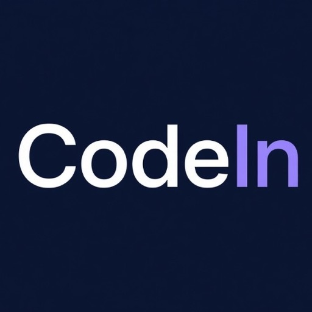
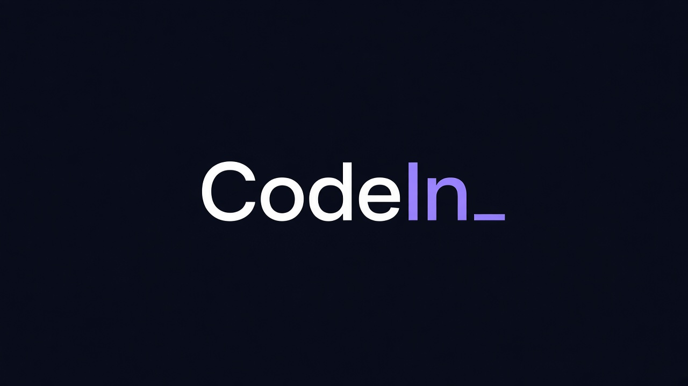

<p align="center">
  
</p>

<h1 align="center">
  <code style="font-size:1.4em;background:transparent;border:none;color:#E8E9ED">{</code><b style="color:#FFFFFF">Code</b><b style="color:#A799FF">In</b><code style="font-size:1.4em;background:transparent;border:none;color:#A799FF">}</code>
</h1>

<p align="center">
  <strong>Idea → AI code → pump.fun coin → live deploy</strong><br/>
  Terminal-native launchpad. One command. Explicit confirm. Streaming build.
</p>

<p align="center">
  
</p>

<p align="center">
  <a href="https://github.com/codeinproofs/codein"></a>
  <a href="https://github.com/codeinproofs/codein-sdk"></a>
  <a href="https://github.com/codeinproofs/codein-cli"></a>
  <a href="https://github.com/codeinproofs/codein-adapters"></a>
</p>

---

### Repos that actually install

| | Package | Command |
|---|---------|---------|
| 01 | [`codein`](https://github.com/codeinproofs/codein) | `docker compose up` · full product |
| 02 | [`@codein/sdk`](https://github.com/codeinproofs/codein-sdk) | `npm i @codein/sdk` |
| 03 | [`@codein/cli`](https://github.com/codeinproofs/codein-cli) | `npx @codein/cli preview --like discord --idea "…"` |
| 04 | [`@codein/adapters`](https://github.com/codeinproofs/codein-adapters) | `npm i @codein/adapters` |

```bash
npx @codein/cli preview --like discord --idea "realtime community chat"
```

### Stack

`React` · `TypeScript` · `Vite` · `FastAPI` · `SQLModel` · `Redis SSE` · `Solana` · `pump.fun` · `OpenAI`

### Building in public

AI · React · Solana contributors welcome. Mock mode means you can ship PRs without paid keys.

<p align="center"><sub>{ white · violet · navy }</sub></p>
